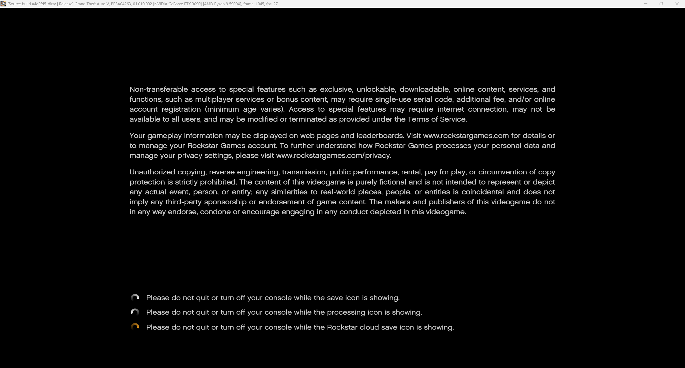
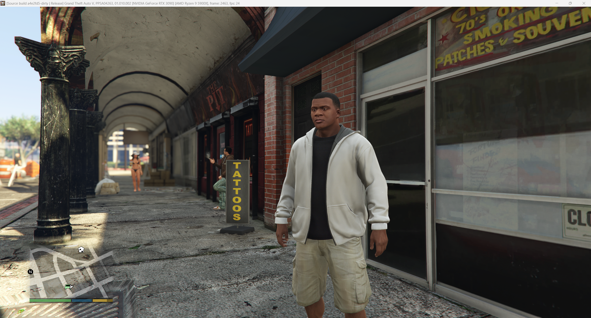

# KytyPS5-GTA

A fork of [KytyPS5](https://github.com/KytyPS5/KytyPS5) focused on running
**Grand Theft Auto V (PS5, PPSA04263 / PPSA04264)**.

This fork is always the latest upstream `main` plus a small set of fixes on top, one commit per
fix. Fixes that are useful beyond GTA V are proposed upstream as pull requests.

For everything about the emulator itself (features, system requirements, building, usage,
licensing), read the [**original KytyPS5 README**](https://github.com/KytyPS5/KytyPS5#readme).

Builds of this fork for Windows, macOS and Linux are published on the
[**Releases**](https://github.com/TheCruZ/KytyPS5-GTA/releases) page (v1, v2, ...).

> [!TIP]
> 🎉 **Performance mode now runs at 60-120 fps in the city!**

> [!IMPORTANT]
> KytyPS5 is not affiliated with Sony Interactive Entertainment, PlayStation or Rockstar Games.
> The project does not distribute games or copyrighted system software. Use only game files that
> you have obtained legally.

## Status

- GTA V is fully playable in Performance mode.
- Fidelity and Performance RT modes work but still run at low fps.
- Performance on an RTX 3090 / Ryzen 9 5900X in Performance mode: 60-120 fps in the city
(v14). It was about 12-13 fps before the GPU optimizations below.

## Other games

Tested on an RTX 3090 / Ryzen 9 5900X with this fork's releases. The version in each cell is the
release where that status or speed was first reached.

| Game | Status | In-game fps |
|------|--------|-------------|
| Grand Theft Auto V (PPSA04263) | Playable (v6) | 60-120 (v14) |
| Red Dead Redemption (PPSA30528) | Playable (v15) | 45-75 (v15) |
| Grand Theft Auto: San Andreas – The Definitive Edition (PPSA03525) | In-game (v15) | 15-30, 30 fps cap (v15) |
| Grand Theft Auto: Vice City – The Definitive Edition (PPSA03530) | In-game (v15) | 15-30, 30 fps cap (v15) |
| Grand Theft Auto III – The Definitive Edition (PPSA03527) | In-game (v15) | 15-30, 30 fps cap (v15) |
| ASTRO BOT (PPSA21564) | In-game (v13) | 20-50 (v16) |
| Demon's Souls (PPSA01341) | In-game (v13) | 8-16 (v16) |
| Marvel's Wolverine (PPSA03671) | Main menu, after a few minutes (v16) | - |
| Ghost of Yōtei (PPSA26344) | Doesn't boot | - |

Workarounds that hide an emulation problem instead of fixing it print a `[HACK]` line to the console and the
log when they are used, so they can be tracked and replaced.

## Fork status

- 95 commits on top of upstream `main` (synced 2026-10-30, upstream 4919fdb6).
- 🎉 16 fixes from this fork (three of them partly) are now part of upstream KytyPS5; 27 more were fixed
there independently, eight of them partly (see [Fixed upstream since the fork started](#fixed-upstream-since-the-fork-started)).

## Fixed bugs and crashes

Each item is one commit on top of upstream `main`.

### Crashes and unsupported shaders

- **Skinning compute shaders**: stores through buffer descriptors (V#) picked from a descriptor
table on the GPU.
- **Ray-hit shading shader (Fidelity/RT)**: GPU-indexed texture (T#) tables are bound as
bindless sampled-image arrays (upstream now looks T#s up in bounded image tables directly,
one specialized image per T#, which GTA V's ray tracing heaps are too large for). Table
elements whose image an earlier rebind replaced are rediscovered before their views are
acquired ("texture requires rediscovery before final acquisition").
- **ASTRO BOT crashes loading a save, entering a galaxy map and leaving the desert level**: a game
`read()` of a whole level or texture file sometimes returned 0 bytes and the game parsed stale
memory. The emulator read files straight into guest memory, and the GPU threads write-protect
again pages they synchronize (here a texture the title screen had used), so Windows' `ReadFile`
failed as a whole. Files are now read into a host buffer and copied into guest memory.
- **ASTRO BOT freezes while diving into Sky Garden**: the graphics queue wrote a flag a compute
queue waited on, but the emulator let the waiting queue look again only after the writer finished
its whole frame, and by then the game had already reset the flag. A queue that writes memory
another queue waits on now lets it run right after the write, as on hardware.
- **ASTRO BOT stuck in the Sky Garden entry tunnel** (stopgap, marked HACK in the code until mip statistics are emulated): the emulator answered the GPU's
mip statistics reports with "every texture sampled at its finest mip", so the texture streamer
kept unloading and reloading textures and the level never started. The reports now say "no
statistics yet".
- **Crash when a gamepad is remapped** by SDL.
- **Fidelity and Performance RT exit on AMD GPUs** ("descriptor set does not fit a pool sized for
it" in `descriptorHeap.cpp`): the emulator asked a descriptor pool for 32 sets of the ray tracing
texture table at once and fewer after a failure, but AMD's driver keeps the room a failed
allocation used, so an empty pool could not hold even one set. Pools are now asked only for the
sets they have room for.
- **Missing letters in the boot legal notice and other text**: the compute shader that copies
glyphs into the font atlas reads the CPU-rasterized bitmaps through DMA; memory without a cached
buffer read as zero, so glyphs on those pages stayed blank. DMA base registers are now cached
before the shader runs.
- **Crash at the car dealership (Franklin and Lamar)**: pixel shader `0xf6b18542ea0e938a` builds
its sampler's border color word from lane data; the untrackable bits are now dropped (border
color only) instead of failing the shader.
- **Streaming crash late in the prologue** ("[RAGE] HDD Streamer" in zlib `inflate_fast`): zlib
keeps locals in the SysV red zone, which Windows overwrites when it delivers the exceptions the
emulator's memory tracking raises. Red zone protection is now enabled by default.
- **Intermittent streaming crash** ("[RAGE] HDD Streamer" in zlib `inflate`/`inflate_fast`, about
once every 100 sessions): the game maps the same direct-memory page again with `MAP_FIXED`
while the streamer decompresses into it. The emulator replaces a mapping by unmapping and
mapping it again, so for a moment the page was gone; guest accesses in that window now wait for
the mapping and are retried.
- **GTA San Andreas Definitive Edition crash** (`TSet::UnhashElements`, read near address 0x20): the
game keeps locals below the stack pointer and addresses them through the frame pointer
(`[rbp+d]`), which red zone protection did not cover, so Windows exception frames overwrote them.
- **"depth attachment feedback loop is not supported by the host"** (seen on a Radeon RX 9060 XT):
draws that sample the depth target they also write need two Vulkan extensions that some drivers
lack. Without them the draw now samples a copy of the depth target taken just before it; GPUs
with the extensions keep the previous path.

### Shader instruction accuracy

- Float inline constants read by 64-bit operands use their double-precision encoding.
- `S_MEMREALTIME` counts at exactly 100 MHz like the console's counter (it ran 25 % fast on
NVIDIA's 1 ns device clock, so guest timeouts and frame pacers expired early; Senaxx).

### Rendering

- Stencil and depth-bias dynamic state is set for every draw (Vulkan validation errors).
- Page faults on pages that cache tracking protects outside the GPU-mapped ranges are resolved
instead of reported as guest crashes.
- **Vehicle damage**: cars no longer deform wildly in collisions (wheels pushed outside the body,
car unable to drive) and snap back later. The CPU reads the damage textures the GPU renders;
GPU-written linear images are now read back to guest memory by default.
- **Ray tracing (Fidelity and Performance RT)**: GTA V's ray tracing dispatches run (BVH
intersections are emulated in shaders on the GPU's regular shader cores) instead of being
skipped, so ray-traced reflections and shadows are drawn (the scalar reads through GPU-selected
V#s are now upstream).
- **Occlusion queries**: the game's occlusion counters come from real Vulkan occlusion queries
instead of always reading visible (the sun's lens flare showed through trees and light glows
through walls). Counters reach the game by the next frame, so water reflections (Michael's pool)
no longer flicker.
- **Red Dead Redemption water reflections**: the sea in the opening boat cutscene no longer loses its
reflection in about one frame of three. The game reads the previous frame's occlusion counters as soon
as the GPU has finished that frame; the counters are now written to its memory at that point instead of
later.
- **GTA Trilogy objects flickering** (San Andreas, Vice City and III Definitive Edition): CJ, cars,
pedestrians, buildings and the radar map no longer vanish for one to three frames while the camera
moves. Each occlusion query is followed by a label that tells the game its counters are ready; the
label was written before the GPU had produced the counters, so the game read zero and hid the
object. The label now lands after the counters, as on the console. This also fixed brief
flickering of horses in Red Dead Redemption.
- **Black smoke and particles**: smoke (Michael's cigar in Father/Son) and small particles render
translucent instead of black. The game clears the particle depth target (R16 float) with a fast
register clear that was ignored, so depth of field blurred the particles dark (decoding the
16-bit clear values is now upstream).
- **Red Dead Redemption menu flicker**: the landscape behind the logo no longer loses its terrain
and rocks in about one frame of five. Freeing a superseded depth image of the dynamic-resolution
menu also dropped the HTile state of its successor at the same address, so the lighting pass
cleared the depth the geometry had just written.
- **Disappearing trees**: the trunks of nearby trees are drawn. GTA V tessellates them up close
and upstream now translates its tessellation shaders (see below); tessellation is enabled by
default in this fork (disable it with `--no-tessellation` or the launcher option).
- **Wrong water level**: the game's water physics saw a flat sea at a fixed level instead of the
waves: boats and jet skis sank into the waves instead of riding them, and the water level seen from
the swimming camera was wrong (with black areas on the water). The physics read the origin of the
GPU-simulated wave grid from a small tiled render target that never reached guest memory. Upstream
merged the fix (small GPU-written tiled images are written back like linear ones) as c07ad621f, but
only behind `--readback-tiled-images` (launcher: "Enable tiled readback"). This fork's launcher
turns it on for GTA V through its recommended settings.

### Performance

- Bindless tables: resolved elements are cached between dispatches and only re-resolved when
their memory changes.
- Reused bindless tables rebind only the slots that changed, and draws keep the texture
descriptions of the slots that did not change (about +3 % in Performance mode).
- Buffer device address synchronization only visits CPU-dirty pages and is skipped when nothing
changed (this replaces the queue of changed ranges of upstream's d58aefde).
- Render-target fast clears whose metadata a compute shader filled no longer read the metadata
back from the GPU (upstream writes proven uniform fills to guest memory since 4059179e; fills
that still run on the GPU are remembered here so the clear value needs no readback; for the rest,
upstream selects the clears on the GPU with conditional rendering since b54057942, and both paths
work together).
- The Vulkan pipeline cache is written every minute by a background thread instead of by the GPU
thread every five minutes, so a crash loses less and the draws do not stall during the write
(upstream now keeps the cache across emulator builds, since d58aefde, and checkpoints it every
five minutes, since 959bee47).
- RELEASE_MEM label writes no longer submit a command buffer each (about 200 submits per frame
down to about 20).
- The per-draw render state is reused instead of zeroing 36 KiB per draw.
- Guest memory reads and range clamps on the GPU thread resolve their mapping without the global
memory lock (per-thread caches validated by a mapping generation).
- Buffer device address synchronization only visits tracking regions dirtied since the last one.
- Shader stage lookup keys are built without per-word vector work.
- The emulated GPU runs as a pipeline of dedicated threads pinned to their own cores (command
processor, draw resolution, execution and Vulkan recording) instead of one thread.
- Shader programs, resource tables and vertex fetch tables are resolved ahead of execution (upstream's
x86 resource-table walker logs what it reads there, and the execution thread checks it), and the
shaders of a new area compile on six worker threads.
- Unmapping memory drains the GPU only when the range holds GPU data or a guest-memory
completion is pending (it drained about 12 times per frame while streaming).
- Streaming no longer stalls frames for 80-280 ms: unmaps run ahead of the emulated GPU's
backlog, and the guest memory map is updated and queried without linear scans or lock
contention (upstream now also keeps its range list in an ordered map, since f7ae86c9).
- Per-draw texture, render-target and image lookups are cached; deleted Vulkan images are
recycled instead of reallocated.
- Indirect draws and indirect dispatches whose arguments the GPU writes (grass and foliage
culling, ray tracing) run from those arguments on the host GPU instead of reading them back:
the scene near the mountain went from about 34 to 60 fps.
- Reads and command-processor writes next to GPU-written data no longer drain the GPU, and
GPU-written bytes are read back on a transfer queue that waits only for their last writer.
- **No more stutter the first time something is drawn**: the driver needs up to half a second
to compile each new pipeline, and the game used to stop while it did (places seen for the
first time dropped to about 18 fps). New pipelines are now compiled in the background and the
draws that need them are skipped meanwhile, so an object may appear a moment late the first
time it is seen while the game keeps running at 40-60 fps. Draws whose results the game reads
back (memory writes, occlusion queries, vehicle damage) still wait. Disable it with
`--no-async-pipelines` or the launcher option.
- **Less slowdown in long sessions**: cached GPU buffers were only released under memory pressure,
so they piled up (from ~350 to ~14,000 in 25 minutes) and every frame kept uploading and
write-protecting memory the game had reused. Buffers that neither the emulator nor any shader
used for about 30 seconds are now released (shaders mark the pages they reach through device
addresses). In a fixed scene after 25 minutes: about 46 fps before, about 52 fps after, the same
as at the start. The game's sequential writes to protected memory take one fault per 64 KB
instead of one per page.
- A vertex shader that reads its vertex buffer descriptors from a table made every draw upload
all the memory the CPU had written (about 16 MB a frame) and protect it again, so the game took
about 2700 write faults a frame. The emulator now works out which memory a shader can reach
through such tables and uploads only that.
- Small per-draw constants reuse the copy made earlier in the same batch of draws, and the lookup
of guest memory mappings for those copies is cached per 64 KB.
- Fewer per-draw checks: the buffers a draw writes are collected once, image use is recorded once
per frame step, and reads of memory the GPU has not written skip the GPU-written checks.
- **Faster shaders on NVIDIA and other 32-wide GPUs** (six commits by EmK530, from
[PR #3](https://github.com/TheCruZ/KytyPS5-GTA/pull/3)): packed and scalar F16 arithmetic runs as
native half-float operations instead of going through F32, buffers that are only read as
constants at small immediate offsets are read through uniform buffer views (the constant cache),
wave64 ballot lane bits project to the lane predicate, and storage buffer reads skip their bounds
check where `robustBufferAccess2` already returns zero. Masked selects whose old value is never
read are dropped (float min/max keep upstream's lowering, which preserves the signed-zero
selection of RDNA2). The new paths need the `shaderFloat16` and `uniformBufferStandardLayout`
device features. Each can be turned off with an environment variable to compare or work around
a problem: `KYTY_NATIVE_F16=0` (native F16) and `KYTY_UNIFORM_BUFFERS=0` (uniform buffer views).
The PR's split waves (wave64 compute run as two 32-wide host subgroups) are not in this fork: they
left wrongly coloured squares in GTA V's ray traced reflections.

### Controllers

- Pads that are not DualSenses (Xbox style) no longer vibrate continuously while driving: the game
sends the vehicle engine through the haptic audio port, meant for the DualSense actuators, and
upstream turned that audio into rumble. Those pads now rumble only through the game's normal
vibration requests (crashes, impacts); `--pad-haptic-rumble` restores the rumble derived
from haptic audio.

## Fixed upstream since the fork started

These problems no longer need a fork commit: KytyPS5 fixed them in its own `main`.

### Taken from this fork 🎉

Upstream commits co-authored by TheCruZ.

| Fix                                                                                                                  | Upstream commit    |
| -------------------------------------------------------------------------------------------------------------------- | ------------------ |
| Fidelity mode device loss in the ray-tracing BVH build (the extra threads of a partial dispatch group stay inactive) | e4aca7a6, 0258bd61 |
| Unsupported `v_bfrev_b32` with an SDWA source (BVH build shaders)                                                    | d890bb19           |
| Ray-tracing buffers whose record count the shader computes                                                           | 8b05b673           |
| Single-DWORD and `FORMAT_X` loads through GPU-selected V#s                                                           | a55a2838, 5f01308b |
| Samplers built with `s_brev_b32` (constant-folded bit reverse)                                                       | 139b564c           |
| `V_ALIGNBYTE_B32` uses only `S2[1:0]` as the byte offset                                                             | f18679e0           |
| Scalar reads through GPU-selected V#s (ray tracing)                                                                  | b4d32394           |
| Written compute descriptors read without an alias proof                                                              | ec3e48cd           |
| `V_CMP(X)_GT_I64` / `V_CMP(X)_GE_I64`, the last 64-bit integer compares (from PR #1 by At0mC3)                       | d247d3d6           |
| Deleting a depth image finds its stencil associations without scanning every cached image (long sessions)            | f4692a45           |
| Partly: bounded material keys for the ray-hit material table                                                         | 843b5778, 1f6be3d5 |
| Partly: 16-bit color fast-clear values (black cigar smoke in Father/Son)                                             | 57c97ebd           |
| Partly: dynamic depth bounds, so deferred lights reuse their pipelines                                               | 98401022           |
| Small GPU-written tiled images are written back to guest memory (water level for boats and jet skis), behind `--readback-tiled-images` (this fork's launcher turns it on in its GTA V recommended settings) | c07ad621f          |
| `V_CVT_PK_U16_U32` / `V_CVT_PK_I16_I32` saturate to 16 bits                                                           | 9210264d           |
| `V_FRACT_F32` / `V_FRACT_F16` / `V_FRACT_F64` results stay below 1.0 (`V_FRACT_F64` was from PR #1 by At0mC3, for PPSA04264) | e864cb20           |

### Fixed by other upstream authors

| Fix                                                                                            | Upstream commit |
| ---------------------------------------------------------------------------------------------- | --------------- |
| Invalid depth upload on shadow cube maps (partial depth views)                                 | 068d7621        |
| `DS_MIN_F32` / `DS_MAX_F32` operands                                                           | e85279ea        |
| Formatted stores to SNORM and USCALED/SSCALED                                                  | de9c15fa        |
| Synchronous CPU readbacks published on the waiting thread                                      | 39e23ac9        |
| Window title updates made presentation wait for the main thread (part of a performance commit) | 7415febd        |
| 64-bit integer compares (all but `V_CMP(X)_GT/GE_I64`)                                         | bb98f264        |
| V# bases selected by a scalar branch in shaders that write memory                              | 488c0aca        |
| Texel offsets of `IMAGE_SAMPLE*_O` (runtime offsets need VK_KHR_maintenance8)                  | 984cfceb, 460a196f |
| GPU-selected formatted loads share one load (Fidelity froze minutes compiling RT shaders)      | 9a7c54da        |
| Partly: dynamic state a draw already set is not recorded again (part of a performance commit)  | 93452b24        |
| Partly: the Vulkan pipeline cache is checkpointed every 5 minutes, so a crash does not lose it (nmzik, with fxpw) | 959bee47        |
| Partly: the Vulkan pipeline cache is kept across emulator builds (part of a performance commit; shadowbeat070) | d58aefde        |
| Partly: guest buffers with device addresses share VMA blocks instead of one dedicated allocation each (part of a performance commit; shadowbeat070) | d58aefde        |
| Fidelity mode device loss in PPSA04264: GLC `BUFFER_LOAD_DWORDX2` is one 64-bit atomic load in the BVH build prefix sums (nmzik) | d1fe1324        |
| `V_CVT_PKRTZ_F16_F32` truncates toward zero for every input (nmzik)                            | 9f88043e        |
| Partly: proven compute buffer fills (DCC metadata) are written to guest memory instead of read back (nmzik) | 4059179e        |
| GTA V's tessellated tree trunks: LS/HS/TES stride reflection across forward branches and wide LDS writes, HS patch constants and TES patch inputs through predicated addresses (Mr. Big Britches, nmzik) | 4a2961cd, 0957f088, c7158912 |
| Partly: virtual memory range edits use an ordered map instead of shifting the whole range list (nmzik) | f7ae86c9        |
| Formatted stores convert to the unsigned 11/10-bit float formats (nmzik)                       | 59d8256b        |
| The address space lock is taken shared for the temporary protection changes of the page manager (about +3-5 % in Fidelity with native ray tracing; nmzik) | 07f64202        |
| **Green puddle reflections in the rain**: MSAA targets resolve into the level and layer the texture cache placed them at (GTA V's reflection cube faces all landed in layer 0; nmzik, usa-ratt) | 17a0f53d        |
| `Inst::AddUse` without the duplicate-use scan (this fork had ported upstream PR #1679 by Nawid3333; nmzik) | 7eb8abb2        |
| Partly: the hot IR operand accessors are inline (this fork keeps NeySlim's iterative `Resolve` and the remaining accessors; Senaxx) | 6cee2dc0        |
| Shader programs and pipelines persist across sessions in a per-game shader store (`--shader-cache`, the launcher's "Cache shaders", on by default; this fork's own program and pipeline stores were replaced by it; nmzik) | 18160043, 83f8bfd3 |
| Fidelity mode exit "scalar resource reads overlap a shader buffer write": the per-draw overlap guard is gone (the fork had accepted the BVH build's reads that precede the dispatch's own writes) | eb3cb472        |
| ASTRO BOT's startup crash: SRT table reads through a null pointer, on a branch side the shader never takes, read zero (the fork had ported PR #1528 by Mikhail Radziukevich; x86 SRT walker) | d7856753, bdf48dcf |
| Partly: range-set additions extend a covering range in place instead of reinserting map nodes (part of a performance commit; nmzik) | 9eef2e14        |

## Known bugs and crashes

- **Occasional crash after switching to Fidelity mid-game**: changing the graphics mode in
Settings from Performance to Fidelity sometimes exits with "MaterializeResources" shortly after.
Loading a save that is already in Fidelity mode works.
- **Flickering character models after switching from Fidelity to Performance**: the player's and
NPCs' models sometimes keep flickering between brightness levels after the graphics mode is
changed from Fidelity to Performance mid-game. Hard to reproduce.
- **Brief black flash right after entering the game**: a few seconds after the player gets control,
some parts of the image turn black for a single frame and then render correctly. Rarely (if ever)
noticeable later in the session. Something similar seems to happen in Demon's Souls.
- **Red Dead Redemption: brief animation hitches**: animations sometimes seem to pause or slow down
for an instant and then continue normally, more noticeably below 50 fps.
- **AMD GPUs**: the log warns "format Bc5UnormBlock does not support storage access;
block-compressed textures written by the guest will not render".

## Screenshots

## New prologue video with pipeline cache **empty** at 60 fps!!

- v6 compiles the shaders in background without freeze the image and show the models when they are ready, the game is running in 2k resolution

## 30 min gameplay video 60 fps stable at 2k resolution with v9 release

## Reporting a problem

Open an issue with the crash message, the game mode (Performance, Performance RT or Fidelity) and
where in the game it happened. Crash reports from the emulator include the faulting thread,
registers and stack, which are usually enough to locate the problem.